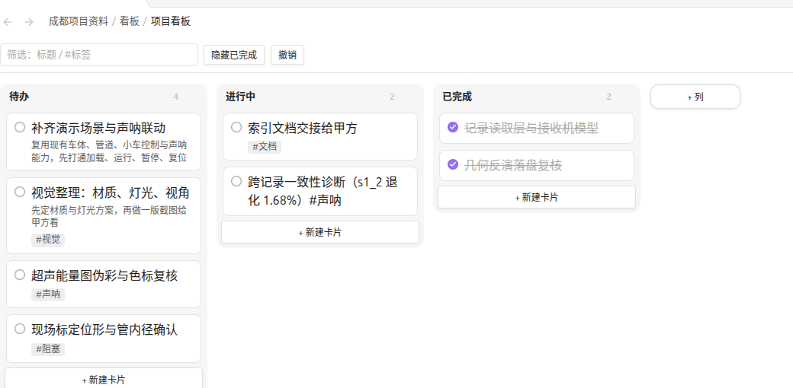
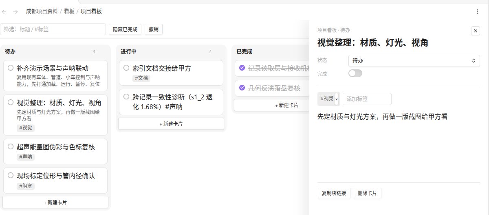

# Simple Board

Obsidian 的轻量看板插件：**一个看板就是一个 `.board.md` 文件**，结构写在一个自描述的 YAML 块里，卡片是其中一行扁平记录。不装插件也读得懂，git diff 也干净。





````
项目看板.board.md

```yaml board
version: 1
columns: [待办, 进行中, 已完成]
cards:
  - {id: a1b2c3, column: 待办, title: 补齐演示场景与声呐联动, tags: [声呐]}
  - {id: r5ip3c, column: 待办, title: "视觉整理：材质、灯光、视角", tags: [视觉]}
  - {id: g7h8i9, column: 已完成, title: 记录读取层与接收机模型, done: true}
```

<!--card a1b2c3-->
复用现有车体、管道、小车控制与声呐能力，先打通加载、运行、暂停、复位。
<!--/card-->
````

后缀 `.board.md` 就是身份：文件树里显示成 `项目看板.board`，双击用看板打开，随时可切回 Markdown 看源码。文件仍是 Markdown，全文搜索、反链、图谱照常生效。

**为什么卡片是扁平记录**：换列只改那一行里的 `column` 值，正文段落原地不动；卡片也是文件里的一行，`rg 块id` 能直接命中。

## 特点

- **自描述格式**：结构块里 `version` / `columns` / `cards` / `id` / `column` / `title` / `tags` / `done` 都是显式字段，人和 agent 都不需要额外文档就能读改。
- **改动落在最小处**：未改动的卡片按原始行写回，改标题只动一行、换列只动一个值、正文在独立段落里。
- **后缀驱动、双向切换**：「打开为看板 / 打开为 Markdown」在视图头部按钮、命令面板和文件右键菜单里都有；手动选过 Markdown 的文件不会被自动切回。
- **指针拖拽**：跨列拖动有真实占位缝，落点所见即所得；`Esc` 取消。
- **卡片只改标题，详情进覆盖层**：悬停点铅笔就地改标题；点卡片任意处从右侧滑出覆盖层，编辑状态、完成、标签与正文。`Esc` 关闭，不挤压看板列宽。
- **多选批量移动**：`Shift`/`Cmd` 点选，再拖或按 `←` `→` 整批换列。
- **过滤**：`标题片段`、`#标签`，可一键隐藏已完成；列头显示可见卡片数。
- **跟随主题**：只用 Obsidian 的 CSS 变量配色，深浅色与第三方主题自动适配。
- **安全写入**：原子读改写（`vault.process`），文件被外部改动时提示并重载，不静默覆盖；认不出的手写段落原样保留，保存时不吃掉别人的东西。
- **可撤销**：工具条「撤销」回退最近 30 次结构性操作。

## 使用

| 操作 | 方式 |
| --- | --- |
| 新建看板 | 文件夹右键菜单、命令面板、左侧 ribbon；点了就在该文件夹生成 `未命名看板.board.md` 并打开 |
| 改名看板 | 点看板顶部的大标题，`Enter` 保存、`Esc` 取消；文件名、视图头与标签页一起改 |
| 自动进看板 | `.board.md` 文件自动用看板视图打开（可在设置关闭） |
| 打开为 Markdown | 看板视图右上角的按钮、命令面板、文件右键菜单；看的是同一份文件的源码 |
| 切换笔记 | 同一叶子里换文件时视图自动对齐：`.board.md` 用看板打开，其余退回 Markdown |
| 新建位置 | 文件夹右键菜单用该文件夹；命令与 ribbon 用设置里的默认目录，没设就用当前文件所在目录 |
| 打开/关闭详情 | 点卡片任意处再点一次即收起；也可用右键菜单或卡片聚焦时 `Enter` |
| 编辑标题 | 悬停卡片点右上角铅笔；`Enter` 保存、`Shift+Enter` 换行、`Esc` 取消 |
| 切换详情 | 侧栏开着时点别的卡，直接换成那张卡的内容 |
| 勾选完成 | 点左侧圆圈，或卡片聚焦时按空格 |
| 换列 | 拖拽；卡片菜单「移到左列 / 右列」；详情里改「状态」；多选后用工具条 `←` `→` |
| 关闭详情 | `Esc`、右上角 ×，或点覆盖层外任意处 |
| 重命名列 | 点列标题 |
| 列操作 | 列头 `⋯`：插入列、清除本列已完成、删除本列 |
| 筛选 | 顶部搜索框，支持 `#标签`；`Esc` 清空 |

## 安装

手动：把 `main.js`、`manifest.json`、`styles.css` 放进 `<库>/.obsidian/plugins/simple-board/`，然后到「设置 → 第三方插件」启用。

BRAT：添加本仓库地址即可跟踪最新发行版。

## 开发

```bash
npm install
npm run dev      # 监听编译到 main.js
npm test         # 解析 / 序列化 / 移动 / 过滤的单测
npm run build    # 类型检查 + 生产构建
```

开发时把仓库目录软链到 `<库>/.obsidian/plugins/simple-board/`，改完在 Obsidian 里用「重新加载应用」或 `Reload plugins` 命令生效。

### 代码结构

```
src/board/   纯数据层（无 Obsidian 依赖，单测覆盖）：
             model   模型与身份判定（后缀）
             parse   文件切分与归一（不碰 YAML 解析器）
             io      接上 Obsidian 的 parseYaml
             serialize 写出结构块与正文段落
             ops     卡片与列的全部操作
             filter  过滤与标签抽取
src/ui/      卡片手势与拖拽（Pointer Events）、卡片覆盖层编辑器（card-editor）
src/view.ts  看板视图：渲染、编辑、菜单、写盘、覆盖层开合
src/main.ts  插件入口：注册视图、命令、设置
```

数据层的原则：`parseBoardFile` 读文件 → 内存模型 → `serializeDoc` 写回，出口只有一个。内容没变的卡片按原始行输出，只有被编辑过的卡片才重建，所以插件不会制造无意义的 diff。

## 已知边界

- 卡片只有一层，不支持子卡片。
- 「打开为 Markdown」的偏好按文件路径记在内存里，重启 Obsidian 后 `.board.md` 仍默认进看板。
- 不做移动端：手势基于指针，触摸屏不保证可用。
- 一个看板一个文件，卡片不能单独成为笔记；需要那种结构请用普通文件夹 + 双链。
- 覆盖层盖住看板右侧的列，不提供「并排编辑」；需要并排请开两个窗口。
- 正文段落靠 `<!--card id-->` 锚定，卡片删除后留下的孤立段落会原样保留（不静默清理）。
- 结构块里手写的块式卡片（多行）能读，保存时会被规范成一行。

## 许可

MIT
